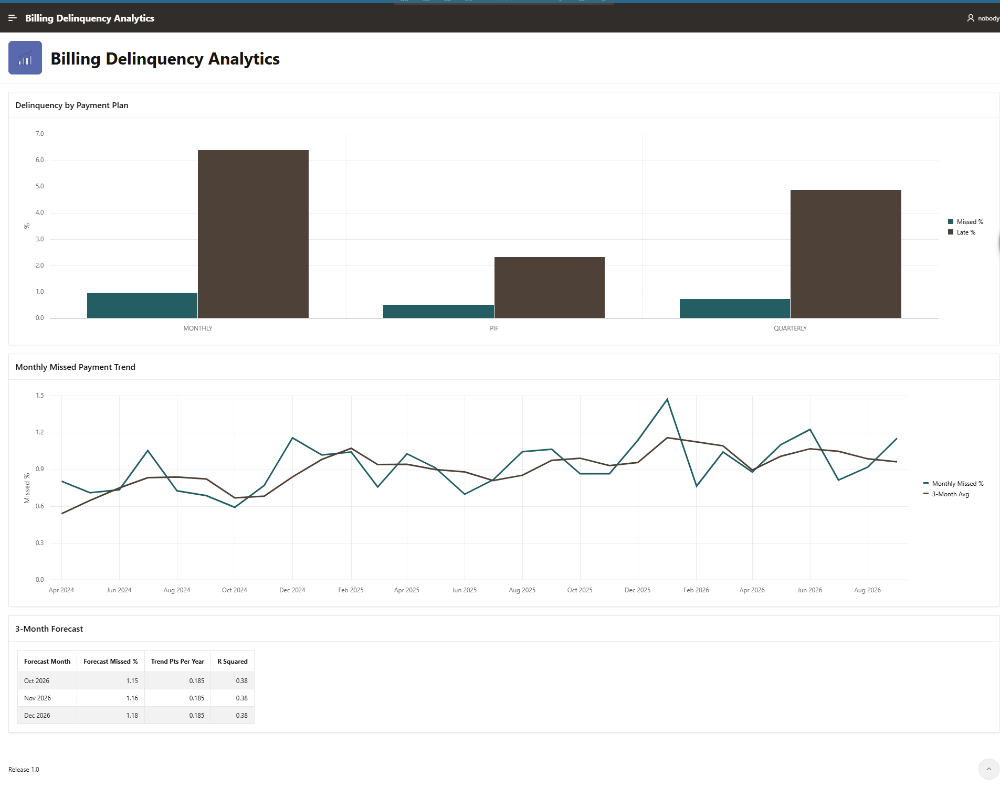
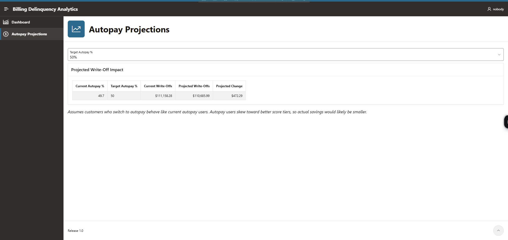

# Billing Delinquency Analytics

Billing delinquency and autopay scenario analysis on a synthetic P&C insurance book, built with **Oracle SQL** and an interactive **Oracle APEX** dashboard.

**🔗 Live app:** [Billing Delinquency Analytics](YOUR_APP_URL_HERE)



---

## The business question

Missed installments turn into cancellations and write-offs. This project looks at three questions a billing or finance team would ask:

1. **Where does delinquency come from?** Which payment plans, autopay statuses, and risk tiers drive missed payments and bad debt?
2. **Where is it heading?** What's the trend, and what should we expect over the next quarter?
3. **What would autopay adoption be worth?** If more customers moved to autopay, how much would write-offs change?

---

## The data

All data is **synthetic**. No real policyholder data is used.

| Table | Rows | Grain |
|---|---|---|
| `POLICIES` | 20,000 | One row per policy: payment plan, autopay flag, score tier, A/B group |
| `INSTALLMENTS` | 131,425 | One row per billed installment: due date, status (paid / late / missed), written-off amount |

The data was generated with [`data/generate_billing_data.py`](data/generate_billing_data.py), which builds in realistic patterns:

- Three payment plans: **Monthly**, **Quarterly**, and **Paid in Full (PIF)**
- Autopay users skew toward better score tiers
- A Dec/Jan seasonal bump in missed payments
- A slow upward drift in delinquency over time
- A reminder-email A/B test, split by even vs. odd policy number

**Reproducible:** the generator uses a fixed random seed, so running

```bash
pip install pandas numpy
python generate_billing_data.py --policies 20000
```

recreates the exact dataset used in the app. The CSVs were then loaded into Oracle APEX through **SQL Workshop → Data Workshop**.

---

## The SQL

All analysis queries are in [`sql/analysis_queries.sql`](sql/analysis_queries.sql).

| # | Query | Techniques | Used in app |
|---|---|---|---|
| 1 | Delinquency by payment plan | CTE, conditional aggregation | Bar chart |
| 2 | Risk segments (plan × autopay × tier) | `RANK()`, `RATIO_TO_REPORT`, running totals | — |
| 3 | Monthly trend | `LAG` (year-over-year), 3-month moving average | Line chart |
| 4 | Reminder email A/B test | Relative lift, two-proportion z-score | — |
| 5 | 3-month forecast | `REGR_SLOPE`, `REGR_INTERCEPT`, `REGR_R2`, `CONNECT BY LEVEL` | Forecast table |
| 6 | Autopay scenario | Bind variable from page input, weighted projection | Autopay Projections page |

---

## The app

Built in Oracle APEX with two pages:

**Dashboard.** Delinquency by payment plan, the monthly missed-payment trend with a 3-month moving average, and a 3-month forecast.

**Autopay Projections.** A what-if tool. Pick a target autopay adoption rate (40–80%) and the projected write-offs recalculate live.



The APEX app export is in [`apex/f188112.sql`](apex/f188112.sql). Import it through **App Builder → Import** in any APEX workspace, then load the two tables.

---

## Key findings

**Payment plan matters most.** Monthly plans have the highest late rate (~6.4%) and missed rate (~1.0%). Quarterly plans come next (~4.9% late), and Paid in Full is lowest (~2.3% late, ~0.5% missed).

**Delinquency is seasonal.** Missed payments spike in December/January both years, peaking around 1.5% in Jan 2026, then fall back.

**The trend is drifting up.** The regression trend adds about **0.19 points per year** to the missed rate, with a forecast of ~1.15–1.18% for Oct–Dec 2026.

**Autopay adoption has real value.** Current autopay adoption is **49.7%**, with **$111K** in write-offs. The scenario model projects:

| Target autopay | Projected write-offs | Change |
|---|---|---|
| 40% | $124,698 | −$13,539 |
| 60% | $96,674 | +$14,484 |
| 70% | $82,663 | +$28,496 |
| 80% | $68,651 | +$42,507 |

---

## Caveats

- **Autopay selection bias.** The scenario assumes customers who switch to autopay behave like current autopay users. Current users skew toward better score tiers, so real savings would likely be **smaller** than projected. A fairer estimate would compare autopay vs. non-autopay *within* each score tier.
- **Moderate forecast fit.** The linear trend has an R² of **0.38**, so it explains only part of the month-to-month variation. Seasonality accounts for much of the rest. Treat the forecast as directional.
- **Early-month ramp-up.** Jan–Mar 2024 are excluded from the trend chart. The book was still ramping up and only first installments were due, which made those months look artificially low.
- **Synthetic data.** The patterns are built in on purpose. The point of the project is the method, not the specific numbers.

---

## Possible next steps

- Add a seasonal factor to the forecast
- Add a grace-period scenario (e.g., 10 → 20 days)
- Re-run the autopay scenario within score tiers to correct for selection bias

---

## Repo structure

```
├── README.md
├── apex/
│   └── f188112.sql              # Oracle APEX app export
├── data/
│   └── generate_billing_data.py # Synthetic data generator
├── sql/
│   └── analysis_queries.sql     # Six analysis queries
└── screenshots/
```

---

*Built by Antonio Diaz.*
